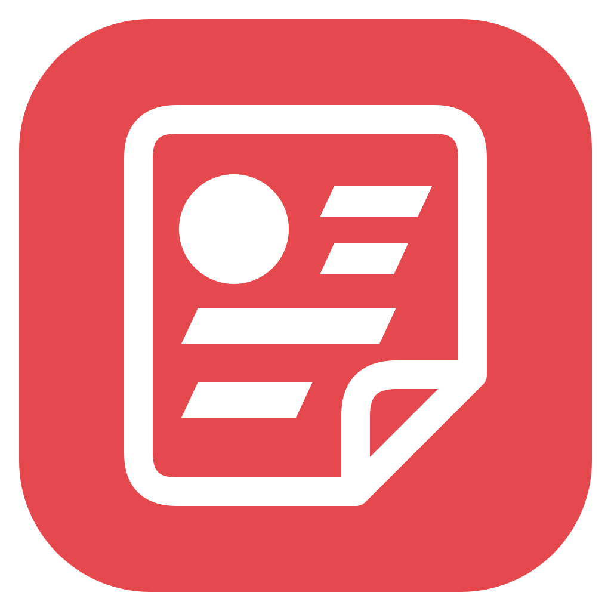
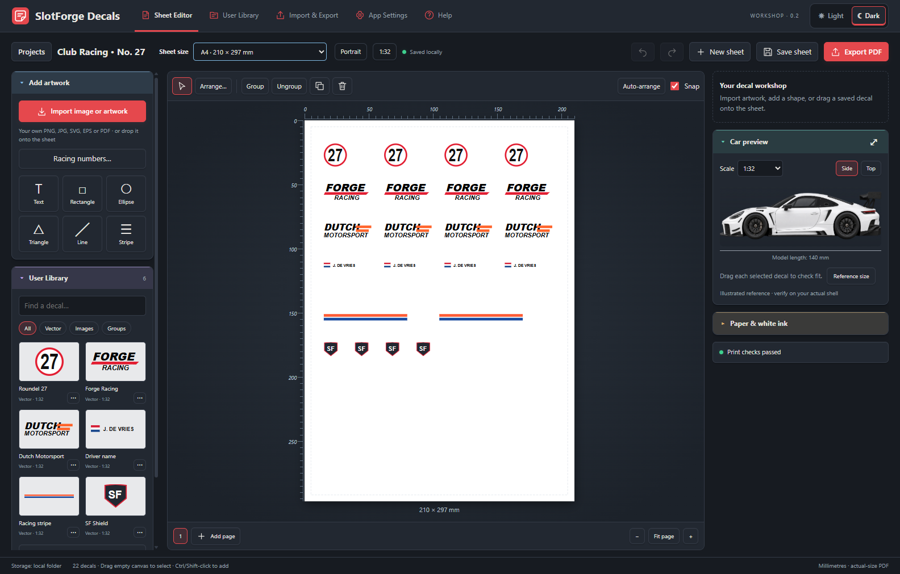

  

# SlotForge Decals

**Design. Scale. Print. Decal sheets for your slotcars.**

Bring your own artwork, size it in millimetres, check it against a car reference and arrange a sheet ready for decal paper. Save reusable designs in your library, share editable files with other builders, and export a PDF for your home printer or print shop. Everything runs locally, without an account.

**[Download for Windows, macOS and Linux](https://github.com/theDutchmanJames/SlotForgeDecals/releases/latest)**

**On this page:** [App Collection](#slotforge-app-collection) · [Features](#what-you-can-do) · [Installation](#install-and-open-decals) · [First sheet](#your-first-decal-sheet) · [Printing](#printing-at-the-right-size) · [Saving and sharing](#saving-and-sharing)

*Example sheet in the actual app. Select the image to view it full size.*

## SlotForge App Collection

SlotForge Decals is part of the **SlotForge App Collection**—apps for building tracks, managing your cars, designing their appearance and exploring their performance.

-  **[SlotForge Timing](https://github.com/theDutchmanJames/SlotForgeTiming)** — Time laps, manage practice sessions and race meetings, and create custom race displays.
-  **[SlotForge Paddock](https://github.com/theDutchmanJames/SlotForgePaddock)** — Organize your slotcar collection, photographs, parts, setups and maintenance in a virtual garage and workshop.
-  **[SlotForge Telemetry](https://github.com/theDutchmanJames/SlotForgeTelemetry)** — Explore gearing, motors, tyres and weight, compare setups, and analyse recorded lap times.
-  **[SlotForge Livery](https://github.com/theDutchmanJames/SlotForgeLivery)** — Plan paint schemes, stripes, race numbers and decals on editable 2D car templates.
-  **[SlotForge Circuit](https://github.com/theDutchmanJames/SlotForgeCircuit)** — Design slotcar tracks, including routed and FreeForm layouts, and export track data for Timing's Live Tracker.

Visit each app's repository for its features, downloads and getting-started guide. Circuit was previously called SlotForge Track Builder; its repository is now SlotForgeCircuit.

## What you can do

### Import and prepare your artwork

- Import **PNG, JPEG, WebP, SVG, EPS and PDF**, or drop a file onto the sheet. Choose a page when importing a multi-page PDF.
- Enter printed dimensions directly or convert artwork from one model scale to another.
- Crop images, remove an edge-connected background colour and trim transparent borders. The original stays available for restoration.
- **Trace a bitmap into vector paths**, compare the result, refine colours and remove unwanted shapes. Best suited to logos, numbers and flat-colour graphics.
- See whether artwork is raster, vector, traced vector or a mixture. Saving a PNG in a PDF alone does not turn it into a vector.

### Create and arrange decals

- Add editable text, custom fonts, curved lettering, shapes, lines and racing stripes.
- Create racing-number roundels and plates, including matching pairs. Add silhouette outlines to imported artwork.
- Choose **A4, A5 or Photo 4×6 in** from the **Sheet size** picker beside the project name. All support portrait and landscape, millimetre rulers, margins and cutting gaps.
- Drag a selection rectangle or use Ctrl/Command/Shift-click to select several decals. Move, resize, rotate, mirror, group, lock and layer them.
- Repeat selections in rows and columns, align edges, distribute equal gaps, move artwork between pages or use Auto-arrange.
- Edit elements inside groups, including nested groups, with undo and redo.
- Switch between light and dark themes.

### Check the fit on your car

All selected decals appear in the side or top car preview at their printed dimensions. Enter your model's measurements or import your own straight-on reference pictures. Drag decals on the car without moving them on the sheet.

Open the enlarged preview to adjust a selected decal's width and height; the sheet updates too. The supplied car is illustrative. This is a **2D sizing aid**, so confirm the final fit with a plain-paper proof.

### Build a library and share your work

Explicitly save finished decals with names and tags. Place independent copies on new sheets, or export selected designs for another Decals user. Saved projects, version history, workspace recovery and portable backups support everyday editing.

## Install and open Decals

You do **not** need Node.js, Git or programming experience to use a released app.

1. Open [Releases](https://github.com/theDutchmanJames/SlotForgeDecals/releases/latest).
2. Expand **Assets** if the download list is hidden.
3. Choose the file for your computer. GitHub's **Source code** downloads are for developers; they are not the app.

| Your computer | Download |
| --- | --- |
| Windows, Intel or AMD 64-bit | `SlotForgeDecals-…-windows-x64.exe` |
| Mac with Apple Silicon (M1 or newer) | `SlotForgeDecals-…-mac-arm64.dmg` |
| Mac with an Intel processor | `SlotForgeDecals-…-mac-x64.dmg` |
| Ubuntu/Debian Linux, Intel or AMD 64-bit | `SlotForgeDecals-…-linux-amd64.deb` |
| Other compatible Linux, Intel or AMD 64-bit | `SlotForgeDecals-…-linux-x86_64.AppImage` |
| Linux on ARM64 | The Linux `arm64.deb` or `arm64.AppImage` |

### Windows

Download the portable `.exe`, put it in a folder you want to keep, and double-click it. It extracts its runtime automatically; there is no separate installation. Windows releases are unsigned and may show an unknown-publisher warning. Check the download's origin before deciding to open it.

### macOS

Requires macOS 15 or newer.

Open the `.dmg`, drag **SlotForge Decals** into **Applications**, then open it from Applications. You can eject the disk image afterwards. **Apple menu → About This Mac** shows whether you need Intel or Apple Silicon. A ZIP containing the app is also available.

Mac releases are ad-hoc signed, **not Apple-notarized**. If macOS blocks the app, check its origin and use the per-app approval in **System Settings → Privacy & Security**, if offered. Keep system-wide security protections enabled.

### Linux

On Ubuntu or Debian, open the `.deb` with your software installer, choose **Install**, then launch Decals from the applications menu.

For an AppImage, save it in a permanent folder, open **Properties → Permissions**, allow it to run as a program, and double-click it. Some distributions need FUSE compatibility support. The `.deb` is an alternative on supported Debian-based systems.

Packages are built on Ubuntu 24.04 for compatible modern distributions. Run the app as your normal user, with its sandbox enabled. Older distributions may need a source build on that system.

### Updating

Export a backup, close Decals, then replace the portable executable or install the newer package. Your workspace is separate from the app, so updating does not replace your artwork. Automatic in-app updating is not included. See the [release notes](RELEASE_NOTES.md) for changes in the latest release.

## Your first decal sheet

1. Open the example sheet to explore, or start a blank sheet. Choose **A4**, **A5** or **Photo 4×6 in** using **Sheet size** in the top bar.
2. Choose **Import image or artwork**, select a file, then set its printed width and model scale.
3. Add text, shapes or a racing-number template.
4. Select decals and review them on the car. Set the model measurements to match your car.
5. Arrange the page, leaving cutting space. Review **Print checks** for overlaps, low resolution and artwork outside the margins.
6. Save useful designs to the library and save your editable sheet.
7. Export a sizing proof, print it on ordinary paper at **100%**, and check the fit before using decal paper.

The [user guide](docs/USER-GUIDE.md) explains image preparation, tracing, outlines, group editing, arrangement and recovery.

## Printing at the right size

PDF pages match your selected paper size, in portrait or landscape:

| Sheet size | Portrait dimensions |
| --- | --- |
| A4 | 210 × 297 mm |
| A5 | 148 × 210 mm |
| Photo 4×6 in | 101.6 × 152.4 mm |

All pages in a project share one paper size. Switching sizes keeps decal dimensions and positions unchanged; review **Print checks** and rearrange anything outside the smaller sheet. Existing projects default to A4.

Choose matching paper in your printer settings and print at **Actual size / 100%**, with **Fit to page** disabled. Measure the proof's labelled reference bars before using decal paper. Bars are 100 mm, with a 50 mm bar on the short side of a 4×6-inch sheet.

Supported vector artwork stays vector; bitmap artwork stays raster. Tracing creates an approximation and cannot recover detail missing from the image.

Optional white-ink output creates a named spot separation for compatible printers and RIP software. Confirm the spot name, ink order and settings with your print shop. The white plate uses a 600 PPI silhouette and has not been tested on a physical white-ink printer. Output preserves RGB artwork; it is not a certified PDF/X or managed CMYK colour proof.

## Saving and sharing

Editable A5 and Photo 4×6 sheets and their workspace backups require **Decals 0.2.13 or newer**. PDFs can be viewed and printed without Decals; decal packs remain compatible.

| Format | Use it for |
| --- | --- |
| **PDF** | Finished sheets for printing and viewing |
| **SVG** | Exported decal artwork; embedded images remain raster |
| **`.sfsheet`** | Editable sheets with artwork, fonts, sizes and car references |
| **`.sfdecal`** | Saved decals that another Decals user can import |
| **`.sfbackup`** | The current workspace, library and preferences |

The library holds up to **1,000 decals**. A sharing pack contains up to **500 decals**; export larger collections in batches. Only share artwork and fonts you have permission to redistribute.

Your default workspace is **Documents/SlotForge Decals**, using your operating system's Documents location, including redirected folders. **Settings → Open workspace folder** shows the actual location. It contains the workspace, saved projects, older project versions, exports and automatic backups. Separately copy the **Projects** folder to back up all saved sheets and histories; a workspace backup does not include that whole folder.

## Practical limits

- Complex SVG artwork may need unsupported effects expanded or simplified. External resources and unsafe content are excluded.
- EPS and PDF conversion happens locally through bundled Ghostscript and MuPDF.
- The car preview does not simulate a 3D wrap or stretching over curved bodywork.
- Sharing is through files. Online accounts, a gallery and direct Livery integration are not included.

## Development

See [build instructions](docs/BUILDING.md) for local setup, macOS/Linux builders and automated releases. GitHub Actions builds on each target operating system, checks the packaged apps and publishes only after every platform and source archive passes. [Testing notes](docs/TESTING.md) describe the checks.

## Licence

SlotForge Decals is free and open source under the [GNU Affero General Public License, version 3 or later](LICENSE), matching Livery. Commercial redistribution is permitted subject to its requirements. Your own original decals remain yours; third-party artwork and font rights remain separate.

Each release provides corresponding application and converter sources alongside the app downloads. Retain the applicable licences and supply corresponding sources when redistributing. See [third-party notices](THIRD-PARTY-NOTICES.txt).
