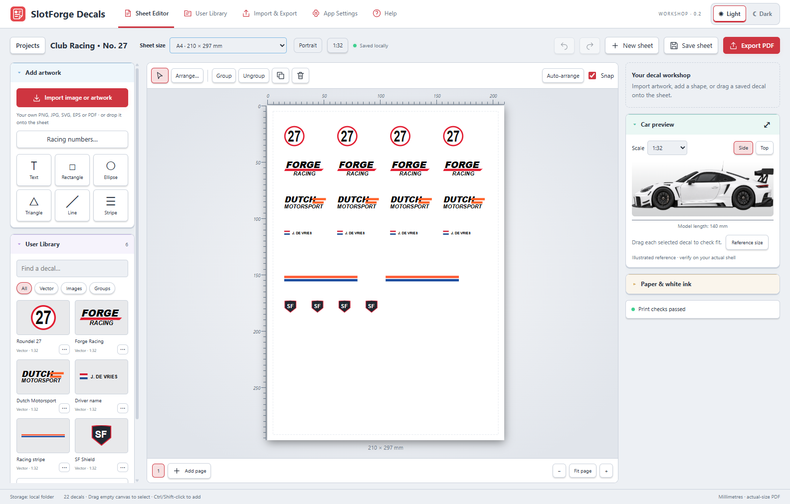
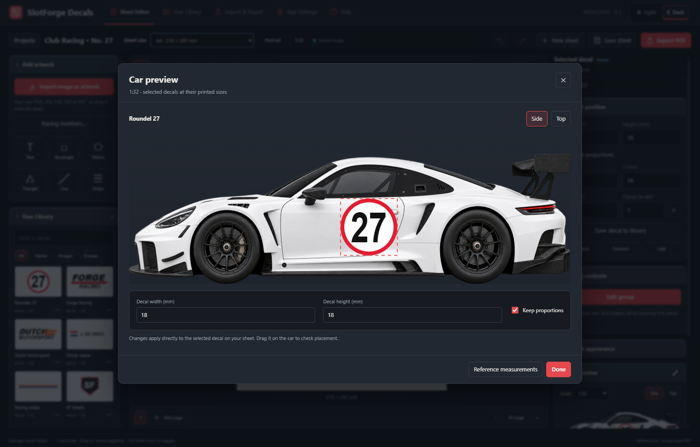

  
  

 

# SlotForge Decals

**Create decals. Check the fit. Print at the right size.**

SlotForge Decals is a desktop app for preparing printable slotcar decals. Import your own artwork, add text and shapes, set exact dimensions, and arrange everything on A4, A5 or 4×6-inch sheets. Check your designs against a car reference, then export a PDF for your home printer or print shop.

Build a reusable decal library and share editable designs with other enthusiasts. **Everything runs locally, without an account.**

[Download Decals](https://github.com/theDutchmanJames/SlotForgeDecals/releases/latest) · [See the app](#pictures-of-the-app) · [Explore the features](#features-and-functionality) · [How to install](#how-to-install) · [Report a problem](#reporting-problems)

## SlotForge App Collection

SlotForge Decals is part of the **SlotForge App Collection**—apps for building tracks, managing your cars, designing their appearance and exploring their performance.

-  **[SlotForge Timing](https://github.com/theDutchmanJames/SlotForgeTiming)** — Time laps, manage practice sessions and race meetings, and create custom race displays.
-  **[SlotForge Paddock](https://github.com/theDutchmanJames/SlotForgePaddock)** — Organize your slotcar collection, photographs, parts, setups and maintenance in a virtual garage and workshop.
-  **[SlotForge Telemetry](https://github.com/theDutchmanJames/SlotForgeTelemetry)** — Explore gearing, motors, tyres and weight, compare setups, and analyse recorded lap times.
-  **[SlotForge Livery](https://github.com/theDutchmanJames/SlotForgeLivery)** — Plan paint schemes, stripes, race numbers and decals on editable 2D car templates.
-  **[SlotForge Circuit](https://github.com/theDutchmanJames/SlotForgeCircuit)** — Design slotcar tracks, including routed and FreeForm layouts, and export track data for Timing's Live Tracker.

Visit each app's repository for its features, downloads and getting-started guide. Circuit was previously called SlotForge Track Builder; its repository is now SlotForgeCircuit.

## Pictures of the app

<table>
  <tr><th width="50%">Sheet editor · dark theme</th><th width="50%">Sheet editor · light theme</th></tr>
  <tr>
    <td></td>
    <td></td>
  </tr>
</table>

*Actual app screenshots using the included example artwork. Click any image for a closer look. The car preview is a 2D sizing reference; confirm the fit on your model with a plain-paper proof.*

## Features and functionality

### Bring your own artwork

**Start with the logos, numbers and graphics you want on your car.** Import **PNG, JPEG, WebP, SVG, EPS and PDF**, or drag a file onto the sheet. For a multi-page PDF, choose the page you want to import.

Supported SVG paths, gradients, clipping, masks and symbols retain their vector detail. EPS and PDF conversion runs locally through bundled Ghostscript and MuPDF. Complex vector files with unsupported effects may need preparation in their original editor; external resources and unsafe content are rejected with an explanation.

The app identifies artwork as **Raster**, **Vector**, **Traced vector** or a mixture, so you can see what you are working with. Bitmap portions remain bitmap images even when included in an SVG or PDF.

### Prepare images and trace them into vectors

Crop a photograph or logo, remove a plain background colour connected to its edges, and trim empty transparent borders. Preview against transparent, light or dark backgrounds. Cropping preserves the artwork's physical scale, and the original image remains available for restoration.

Use **Trace image to vector** to turn a bitmap into editable vector paths:

- Compare the original and traced previews, with linked zoom and scrolling.
- Adjust the colour count, detail level and transparency threshold.
- Refine the result by replacing colours or removing unwanted shapes.
- Apply it to the existing decal or add a separate vector copy.
- Undo the change, refine it later or restore the retained image.

Tracing works best for logos, numbers and flat-colour graphics. Photographs, gradients and soft edges are approximated; tracing cannot recover detail missing from the original. Background removal is intended for plain backgrounds, rather than automatic subject selection.

### Create text, shapes and racing graphics

Build your own designs directly on the sheet:

- Add editable text, import custom fonts, adjust spacing and bend lettering into an arc.
- Draw rectangles, ellipses, triangles, lines and racing stripes, with colour and outline controls.
- Create racing-number roundels, oval plates and rectangular plates, individually or as matching pairs.
- Add a silhouette outline around imported artwork, following its outer edge and transparent cut-outs.
- Combine elements into a group, then edit individual parts—including nested groups—without rebuilding the design.

**Edit Vector Artwork** lets you select and remove white background shapes from imported vectors, with preview backgrounds, zoom, undo/redo and a retained original you can restore later. White details stay intact unless selected; SVG artwork stays vector.

Groups keep text and shapes editable. Silhouette outlines retain the source artwork and can be adjusted or removed; a bitmap with a vector outline still contains a bitmap. Save a finished design to the library when you want to reuse it.

### Size decals in millimetres or model scale

**A decal's width and height are its printed dimensions.** Enter the size directly, use confirmed physical dimensions from a vector file, or convert from a known original size and model scale.

For example, a 24 mm-wide decal made for 1:24 becomes 18 mm wide at 1:32. The scale controls can resize selected artwork or the whole sheet's artwork; library copies convert from their saved reference scale. Existing decals keep their dimensions when you choose a new target scale during import.

A scale such as 1:32 cannot determine a logo's size on its own: you still need a physical width or a known reference. Use **Keep proportions** to resize width and height together, or turn it off for independent adjustments.

### Check the fit on your car

All selected decals appear in the **side or top car preview** at their printed dimensions. Enter your model's length, width and height, or import your own straight-on reference pictures for a closer comparison.

Drag decals on the car to try different placements without moving them on the print sheet. Open the enlarged preview to adjust a selected decal's width and height; the sheet and car views update together. Side and top placements are saved with the project.

The supplied GT car is illustrative. This is a **2D sizing aid**, not a measured template for every model, a 3D wrap or a simulation of stretching around curved bodywork. Print a plain-paper proof and check the final fit on the actual shell.

### Arrange sheets without changing decal sizes

Choose **Sheet size** beside the project name, then set portrait or landscape under **Paper & white ink**.

| Paper | Portrait dimensions |
| --- | --- |
| **A4** | 210 × 297 mm |
| **A5** | 148 × 210 mm |
| **Photo 4×6 in** | 101.6 × 152.4 mm |

Every page in a project uses the same paper size. Changing paper preserves decal dimensions and positions; review anything that no longer fits on a smaller sheet.

- Drag a selection rectangle or use Ctrl/Command/Shift-click to select several decals.
- Move, resize, rotate, mirror, group and layer artwork. Lock finished placements and use undo/redo while editing.
- Repeat a decal or selection in rows and columns, with separate horizontal and vertical gaps.
- Align edges or centres, distribute equal gaps, and move selections between pages.
- Use **Auto-arrange** to fit artwork within the margins, adding pages when needed while preserving physical size.

Millimetre rulers, printable margins and cutting gaps help organise the sheet. **Print checks** flag artwork outside the margins, insufficient cutting space, low-resolution images and white-ink settings that need attention. Light and dark themes are available from the top-right controls.

### Save or print part of a sheet

Choose **Slice area…** above the canvas to draw a rectangle over the current page. Enter its left and top position, width and height in millimetres for precise control. Choose **Clip at boundary** to keep exactly that rectangle, or **Expand to include whole decals** to avoid cutting through artwork.

- **Save to library** keeps the slice as one reusable decal, including its transparent background, relative positions, text, vectors, embedded images, fonts and individual white-ink settings. Give it a name and optional tags, then share it through a normal .sfdecal pack.
- **Print this area…** previews a PDF with the original A4, A5 or Photo 4×6 paper size. Only the selected area prints, in its original position.
- **Export cropped PDF…** previews a custom-sized PDF whose page matches the slice, with no rescaling of the artwork.

The original sheet stays unchanged. Saved slices can be moved, rotated and resized as one decal; edit the original artwork before making a replacement slice. Library placement follows model scale, so use the same scale to retain the saved millimetre dimensions. Files containing slices need a version of SlotForge Decals that supports slicing.

Print the PDF at **Actual size / 100%**. Custom paper sizes and physical offcuts depend on your printer’s supported sizes, feed direction and margins; slicing does not position or feed an offcut automatically.

### Export PDFs and check your print size

**Export PDF** produces pages at the selected paper dimensions and orientation. Supported vector artwork, text and shapes remain vectors; imported bitmap content remains raster. Export individual decal artwork as SVG when you need a reusable graphic.

For a reliable printing workflow:

1. Review **Print checks** and resolve sizing or spacing problems.
2. Export a **sizing proof** and print it on ordinary paper.
3. Choose matching paper in your printer settings and print at **Actual size / 100%**, with **Fit to page** disabled.
4. Measure the proof's labelled reference bars and check the cut-out decals against your model.
5. Export the production PDF for your decal paper or print shop.

Proofs use 100 mm reference bars, with a 50 mm bar on the short side of a Photo 4×6 sheet. A PDF preserves page dimensions, but your printer settings still determine the final physical output.

### Prepare artwork for white-ink printing

For a printer or print shop that supports white ink, enable the option under **Paper & white ink**, enter the required spot-colour name, and choose **Colour + white backing** or **White ink only** for each decal.

The PDF includes a named white separation using a 600 PPI silhouette mask. Confirm the spot name, ink order and appearance with your print shop. This has passed PDF structure checks but has **not been validated on a physical white-ink printer**. Output preserves RGB artwork; it is not a certified PDF/X file or a managed CMYK proof.

### Shapes, patterns and clearer editor controls

Open **Shapes & Patterns** for rectangles, ellipses, triangles and lines, plus diamonds, stars, regular polygons, arrows, chevrons, trapezoids and shields. Set exact dimensions, colours, transparent fills and outlines in a live preview. **Checkerboard** and **Racing stripes** create editable groups. Checkerboards grow by rows and columns of a chosen square size. Stripe count ranges from **1 to 12**, with individual widths, equal spacing in millimetres and two alternating colours. Adding stripes or spacing grows the pattern without thinning the stripes; existing double stripes can be upgraded through **Stripe Count & Spacing**. **Racing Number Plates** is in the same toolbox. New polygon shapes require a version of Decals that supports them.

Select one or more canvas items and choose **Save Decal to Library**; multiple items become one reusable grouped decal after you name and save it. Both full library windows use **two columns in List view**. The sidebar library folds closed, offers its own grid/list switch, and scrolls within a height limit as collections grow.

The labelled **Sheet name** field opens renaming. **Portrait / Landscape** switches canvas orientation, **Scale Conversion** opens scale conversion, and **Add Sheet** saves the outgoing work before starting another sheet. The editor’s **Export sheet…** opens the same selection window as Import & Export.

### Draw paths, merge shapes and cut holes

Choose **Path Tool** directly in **Add artwork** to draw freehand strokes or place precise points on the main sheet canvas. Its drawing modes, colours, line width and point controls appear in the right-hand panel. Drag when placing a point to create a curve, close the path to make a filled shape, and adjust individual points and handles afterwards. The editor includes smooth/corner points, point insertion and deletion, line width, fill colours, zoom, panning and drawing undo. Select a saved path and choose **Edit Points & Curves** to continue editing.

Choose **Merge & Cut** directly in **Add artwork**, then select **2–20 filled native shapes or closed paths** on the canvas. Set the operation in the right-hand panel: merge, cut from a chosen base, keep only the overlap or exclude overlapping areas. The result previews on the actual sheet; click **Apply** to keep it. Groups of supported shapes work too. Results retain Bézier curves and transparent holes, stay editable when shared, and remain vector in PDF output. You can keep the originals or replace them; Undo restores the selection. These operations use filled areas, omit outlines and take the base shape’s colour, opacity and ink treatment. For a group, the first child supplies the fill colour. Imported SVGs, images and text are not supported by the shape operations.

Files containing these editable paths need a Decals version with path support.

### Keep a library and share editable designs

Explicitly **Save decal to library** to keep a reusable design with a name and tags. **Decal Library** and **Sheet Library** share grid/list views, search, alphabetical sorting, newest-added and recently-updated sorting. Select items with checkboxes, Ctrl-click or Shift-click; use **Add to Sheet** or **Open Sheet** when you want to edit. Your view and sorting choices are remembered. Editing a sheet copy does not change its library master. Libraries load in pages, with previews fetched as you scroll; opening the app and autosaving no longer load or resend your whole decal collection. Search covers the entire library, and selections stay checked across pages.

| Format | Use it for |
| --- | --- |
| **PDF** | Finished sheets for printing and viewing without Decals. |
| **SVG** | Individual decal artwork; embedded bitmap portions remain raster. |
| **`.sfsheet`** | Editable sheets containing artwork, fonts, sizes and car-reference settings. |
| **`.sfdecal`** | Packs of saved decals that another Decals user can import. |
| **`.sfbackup`** | The current workspace, library, custom fonts and preferences (legacy format). |
| **`.sfdbbackup`** | A complete SQLite backup: all saved sheets, history, decals, artwork and settings. |

The library supports **10,000 decals**, and a sharing pack can contain up to **500**. Send the files yourself; sharing works without an online account. Editable A5 and Photo sheets need Decals 0.2.13 or newer. PDFs can be viewed independently of the app. Only redistribute artwork and fonts you have permission to share.

**Import & Export** puts imports on the left and exports on the right. **Import an Image** adds artwork to the canvas; **Import Decals** and **Export Decals** let you choose saved decals. **Export PDF** keeps the existing print-review workflow. Multi-sheet collection files require a Decals version with collection support; older single-sheet files remain importable. Up to 100 saved sheets can travel in one collection.

Sharing is currently file-based. Online galleries and direct Livery integration are not included.

### Save, share and recover complete sheets

The current workspace saves automatically. **Save sheet / Ctrl+S** saves locally to **Sheet Library**. Select one or more library entries and choose **Export Sheet(s)** to share an editable `.sfsheet` file. Each saved sheet keeps its own paper size, scale, artwork, imported fonts and pages. Use **Choose pages…** to share only part of a saved sheet. **Import Sheet(s)** lets you select which sheets and pages to add as independent copies; your current work stays open.

Earlier saved project versions and recent workspace backups can be previewed and recovered as separate sheet copies. Opening another project or starting a new sheet preserves the outgoing project first.

Your files live in **Documents/SlotForge Decals**, separate from the installed application. **Settings → Open workspace folder** shows the actual location, including redirected Documents folders. Updating the app does not replace that folder.

Sheets, decals, fonts and history now live in **`decals.sqlite`**. Repeated artwork is stored once and reused across saved sheets and versions. On first launch, Decals checks and migrates existing workspace, sheet and history files; the original files stay unchanged as recovery copies.

Use **Settings → Backup & Recovery → Export Complete Backup** to save a verified `.sfdbbackup` containing the whole database. **Restore Complete Backup** keeps a recovery copy before replacing the workspace. The older `.sfbackup` option supports the current sheet and up to 1,000 decals, within its file-size and font limits; it does not contain every saved sheet. Use a complete backup for larger libraries. The on-demand library upgrade keeps a verified pre-upgrade database backup; older app versions cannot open the upgraded database. Keep an independent backup of valuable artwork.

For step-by-step instructions, see the [user guide](docs/USER-GUIDE.md). The [testing notes](docs/TESTING.md) describe what has been checked and the remaining practical limits.

## How to install

Open the **[latest GitHub release](https://github.com/theDutchmanJames/SlotForgeDecals/releases/latest)** and expand **Assets**. Choose the packaged app for your computer; **you do not need Node.js, Git or programming tools**. Source-code downloads are for developers rebuilding the app.

| Your computer | Download |
| --- | --- |
| **Windows · Intel/AMD 64-bit** | `SlotForgeDecals-…-windows-x64.exe` |
| **Mac · Apple Silicon (M1 or newer)** | `SlotForgeDecals-…-mac-arm64.dmg` — added after the separate build passes |
| **Mac · Intel** | `SlotForgeDecals-…-mac-x64.dmg` |
| **Linux · Intel/AMD 64-bit** | `SlotForgeDecals-…-linux-amd64.deb` or `…-linux-x86_64.AppImage` |
| **Linux · ARM64** | `SlotForgeDecals-…-linux-arm64.deb` or `…-linux-arm64.AppImage` |

### Windows

Save the portable `.exe` in a folder you want to keep, then double-click it. It extracts its runtime automatically; no separate installation is required.

Windows releases are unsigned and may show an unknown-publisher warning. Smart App Control can block unsigned downloads entirely; it has no per-app exception. Check that the download came from this repository. Trusted Windows signing is not available in this release.

### macOS

Requires **macOS 15 or newer**. Open the `.dmg`, drag **SlotForge Decals** into **Applications**, then launch it from there. You can eject the disk image afterwards. ZIP downloads are also available.

Choose the Intel (`mac-x64`) or Apple Silicon (`mac-arm64`) download for your Mac. Apple Silicon builds run separately and are added to the same release after their tests pass; if those files are not listed yet, that native download is not ready. **Apple menu → About This Mac** shows your Mac’s processor. Mac releases are ad-hoc signed, not Apple-notarized. If macOS blocks the app, check its origin and use the per-app approval in **System Settings → Privacy & Security**, if offered.

### Linux

Open the `.deb` with your software installer, install it, and launch Decals from the applications menu.

For an AppImage, save it in a permanent folder, allow it to run under **Properties → Permissions**, then double-click it. Some distributions need FUSE compatibility support; the DEB is an alternative on compatible Debian-based systems.

Packages are built on **Ubuntu 24.04** for compatible modern distributions. Run as your normal user with the sandbox enabled. Older distributions may require a source build on that system.

### Your first sheet

Start with the example sheet or a blank page. Choose your paper size, import artwork, set its printed dimensions, and add any text or shapes. Check the fit on the car, arrange the page, save the sheet, then print a sizing proof before using decal paper.

### Updating and building from source

Back up your work, close Decals, then replace the portable executable or install the newer package. Your workspace remains separate from the app. There is no automatic in-app updater. See the [release notes](RELEASE_NOTES.md) for changes.

Developers can follow the [build instructions](docs/BUILDING.md) for local setup and native packaging. Official Windows, macOS and Linux packages are built and tested by GitHub Actions before publication.

## Reporting Problems

Found a bug or an import that does not behave as expected? Check the [existing issues](https://github.com/theDutchmanJames/SlotForgeDecals/issues), then [open a new issue](https://github.com/theDutchmanJames/SlotForgeDecals/issues/new) if it has not already been reported.

Please include:

- Your Decals version from **Help**, operating system and the download you installed.
- The steps to reproduce the problem, what you expected and what happened instead.
- The exact error message and a screenshot, when useful.
- For import problems, the file type and a small example file you are allowed to share.
- For printing problems, the sheet size, orientation, PDF viewer, printer settings and measured output size.

Remove personal information and private artwork from attachments. A minimal example is more useful than your entire workspace. Back up your files before trying recovery steps.

Feature requests are welcome through the same issue tracker. Describe what you are trying to achieve and how it would help your decal-making workflow.

## License and Copyright

Copyright © 2026 **theDutchmanJames and contributors**.

SlotForge Decals is free and open source under the **[GNU Affero General Public License, version 3 or later](LICENSE)**. Commercial redistribution is permitted subject to the licence's requirements. See [NOTICE](NOTICE) for the application's copyright and source information.

Your own original decals remain yours. Third-party artwork and fonts retain their respective rights and licences.

The app includes third-party components, including Ghostscript and MuPDF. Releases provide corresponding application and converter sources alongside the native downloads. Retain the applicable licences and provide corresponding sources when redistributing, as required by those licences. See [third-party notices](THIRD-PARTY-NOTICES.txt) and [asset notes](docs/ASSETS.md).
